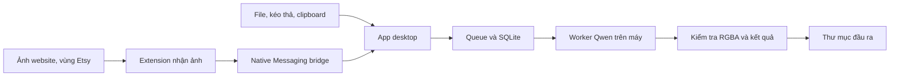
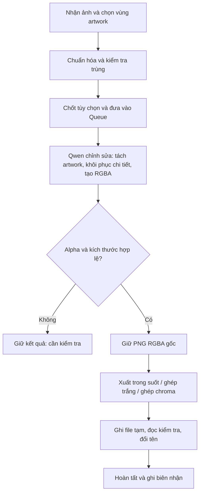

# Artwork Local Studio — workflow và đánh giá khả thi

Ngày đánh giá: **30/09/2026**. Trạng thái tài liệu này: **đề xuất ban đầu trước khi build**. App 0.2.0 đã được triển khai; xem VALIDATION-VI.md cho kiểm thử và phép đo thực tế. Các mục nghiệm thu dưới đây là mục tiêu, không phải kết quả đạt được.

## 1. Kết luận và phạm vi

App có cơ sở kỹ thuật để xây dựng: Qwen-Image-2.1 có trọng số chạy local, chỉnh sửa ảnh và tạo RGBA. Chất lượng tách thiết kế in khỏi mockup là vấn đề phải kiểm chứng bằng ảnh thực tế, không suy ra từ demo tách chủ thể. [Tài liệu Qwen](https://github.com/QwenLM/Qwen-Image-2.1).

Máy chính hiện tại: **RTX 3050 Laptop 6 GB VRAM, khoảng 12 GB RAM**. Tổng RAM vật lý hệ điều hành nhận được là 11,7 GiB, đọc bằng Windows GlobalMemoryStatusEx; khoảng 3,6 GiB RAM trống ở thời điểm kiểm tra. Ổ D còn khoảng 73,2 GiB. Các số trống thay đổi theo ứng dụng đang mở.

Mục tiêu người dùng: **1–2 phút/ảnh 1K**, dùng chính máy hiện tại, có thể cài trên các máy yếu hơn hoặc mạnh hơn. Đây là tiêu chí nghiệm thu, chưa phải tốc độ đã đo.

Đánh giá sơ bộ: **nên thử nghiệm lõi suy luận; chưa đủ bằng chứng để chốt build app đầy đủ theo mục tiêu tốc độ**. 2K native cần đánh giá riêng. Máy yếu hơn có thể chạy chế độ tiết kiệm bộ nhớ hoặc CPU nếu backend hỗ trợ, nhưng không được quảng bá cùng tốc độ.

App đề xuất chỉ dùng Qwen-Image-2.1 làm mô hình xử lý artwork. Encoder và VAE tương ứng là các thành phần bắt buộc của pipeline này. Không thêm mô hình xóa nền, OCR hay mô hình viết lại prompt riêng. Việc đọc ảnh, tính hash, ghép nền, kiểm tra alpha và ghi PNG dùng thuật toán thông thường trên CPU.

## 2. Giấy phép

Qwen-Image-2.1 dùng **Qwen Research License Agreement**, phát hành 20/09/2026. Giấy phép định nghĩa phi thương mại là nghiên cứu hoặc đánh giá và yêu cầu giấy phép riêng cho việc sử dụng mô hình thương mại. Chạy trên máy cá nhân không thay đổi điều kiện này. Mục tiêu nghiên cứu/đánh giá bạn nêu phù hợp với phạm vi đó; nếu chuyển sang tạo hàng POD để bán cần làm rõ quyền sử dụng thương mại. [Giấy phép gốc, điều 1.i và 2](https://huggingface.co/Qwen/Qwen-Image-2.1/blob/main/LICENSE).

## 3. Cơ sở kỹ thuật đã xác minh

| Hạng mục | Bằng chứng và ý nghĩa |
|---|---|
| Mô hình | Bộ sinh ảnh 7B; encoder Qwen3-VL 8B và VAE RGBA. Không thể tính nhu cầu bộ nhớ chỉ từ con số 7B. [Kiến trúc Qwen](https://github.com/QwenLM/Qwen-Image-2.1#architecture) |
| Đầu ra | Có alpha native, chỉnh sửa ảnh và đầu ra native 2K. [Model card](https://huggingface.co/Qwen/Qwen-Image-2.1) |
| Chạy Python | Có QwenImage21Pipeline trong Diffusers; baseline tài liệu là 40 bước, không bật CFG. [Diffusers](https://github.com/huggingface/diffusers/blob/main/docs/source/en/api/pipelines/qwenimage21.md) |
| Thử workflow | ComfyUI có workflow chỉnh sửa và xóa nền; mẫu dùng 25 bước, CFG 1, Euler/simple. [ComfyUI](https://docs.comfy.org/tutorials/image/qwen/qwen-image-2-1) |
| Backend nhẹ | stable-diffusion.cpp hỗ trợ Qwen-Image-2.1, ảnh tham chiếu và alpha. GGUF encoder dùng cho chỉnh sửa còn cần vision projector; VAE phải đúng bản 2.1. [Hướng dẫn backend](https://github.com/leejet/stable-diffusion.cpp/blob/master/docs/qwen_image_2.1.md) |

Các số bước và tham số trên thuộc từng backend; không sao chép CFG/scheduler giữa chúng rồi xem là tương đương.

**Dung lượng file tham khảo, không phải bộ nhớ đỉnh khi chạy:**

| Thành phần | Dung lượng công bố |
|---|---:|
| Denoiser Comfy INT8 | 7,26 GB — [file](https://huggingface.co/Comfy-Org/Qwen-Image-2.1/blob/main/diffusion_models/qwen_image_2.1_int8_convrot.safetensors) |
| Encoder Comfy INT8 | 9,35 GB — [danh mục](https://huggingface.co/Comfy-Org/Qwen-Image-2.1/tree/main/text_encoders) |
| Denoiser Unsloth GGUF Q4_K_M | Khoảng 4,20 GB — [danh mục lượng tử hóa](https://huggingface.co/unsloth/Qwen-Image-2.1-GGUF) |
| Encoder GGUF Q4_K_M | Khoảng 5,03 GB — [Qwen encoder](https://huggingface.co/Qwen/Qwen3-VL-8B-Instruct-GGUF/tree/main) |
| Vision projector F16 | Khoảng 1,16 GB — cùng danh mục encoder phía trên |
| VAE BF16 | Khoảng 676 MB — [VAE](https://huggingface.co/Comfy-Org/Qwen-Image-2.1/tree/main/vae) |

Bộ GGUF tham khảo cộng khoảng 11,1 GB file. Còn phải dành bộ nhớ cho tensor trung gian, attention/cache, ảnh, driver và hệ điều hành. Không cần tất cả thành phần ở GPU cùng lúc; việc di chuyển chúng có chi phí. Không khẳng định RTX 3050 6 GB chắc chắn không chạy được, cũng không khẳng định sẽ đạt 120 giây.

## 4. Kiến trúc đề xuất

Tên làm việc: **Artwork Local Studio**.



**App desktop:** Python + PySide6 là lựa chọn ban đầu để dùng hộp chọn thư mục gốc của Windows, xử lý ảnh và SQLite thuận tiện. Đây là quyết định thiết kế, cần đo bộ nhớ của bản đóng gói khi build. UI không tải mô hình trong tiến trình giao diện.

**Lõi dữ liệu:** SQLite giữ queue, cấu hình, dấu vân tay ảnh, lần thử và biên nhận lưu. Ảnh lớn đặt trong kho file theo hash; SQLite lưu đường dẫn và metadata, tránh giữ toàn bộ queue trong RAM.

**Worker AI:** tiến trình riêng, một job GPU tại một thời điểm. Thử stable-diffusion.cpp/CUDA với GGUF cho máy 6 GB; dùng ComfyUI làm công cụ kiểm chứng workflow và Diffusers làm baseline trên phần cứng đủ bộ nhớ. Chọn backend đóng gói sau benchmark, qua giao diện worker thống nhất: nạp mô hình, xử lý, tiến độ, hủy và giải phóng bộ nhớ.

**Browser bridge:** một extension Manifest V3 giữ chức năng nhận ảnh, menu chuột phải và chọn vùng Etsy. Service worker gửi ảnh/metadata qua Native Messaging đến app. Cơ chế này dùng tiến trình local và stdio, không cần dịch vụ AI bên ngoài. [Chrome Native Messaging](https://developer.chrome.com/docs/extensions/develop/concepts/native-messaging).

App dùng named pipe/stdio hoặc lời gọi thư viện để điều phối worker. Không cần API key hay endpoint cloud trong sản phẩm. Sau khi tải/copy model và runtime một lần, suy luận chạy offline. Nhận ảnh từ website vẫn cần kết nối tới website đó.

## 5. Các tính năng sẽ giữ từ extension

| Nhóm | Thiết kế app |
|---|---|
| Nhập ảnh | Chọn nhiều PNG/JPEG/WebP, kéo thả, Ctrl+V; ảnh qua chuột phải trên web; chọn hình chữ nhật/lasso, zoom/pan trên Etsy. Giữ ảnh gốc, URL nguồn và tọa độ vùng chọn. |
| AI artwork | Chọn chế độ giữ sát nguồn hoặc khôi phục nhẹ; đầu ra 1K/2K; giữ chữ/font, màu in và bố cục; tùy chọn nhập chữ xác nhận, prompt nâng cao. |
| Queue | Chạy tất cả/chọn, sắp thứ tự, dừng sau job, hủy job, thử lại, trạng thái theo bước và thời gian; phục hồi hàng chờ sau mở lại app. |
| Chống trùng | SHA-256 file, hash pixel sau chuẩn hóa, pHash để cảnh báo tương tự; so cả vùng crop và cấu hình. Giữ ledger độc lập với lịch sử thumbnail. |
| Lưu kết quả | Chọn thư mục thật; hiển thị đường dẫn đầy đủ; tự lưu khi đạt kiểm tra; đánh số nếu tên đã tồn tại, tải/lưu lại không chạy AI. |

Trong app mới, thay font bằng GPT và Canva không thuộc phạm vi. Qwen 3.0 Pro qua Pixazo trong ZIP không phải checkpoint Qwen-Image-2.1 local, nên không thể dùng các hành vi của API đó để bảo đảm chất lượng cho app này.

## 6. Workflow xử lý artwork



### A. Nhận và chuẩn hóa

1. Đọc bằng decoder ảnh, kiểm tra kích thước và số pixel; không chỉ tin đuôi file.
2. Sửa hướng EXIF, chuyển không gian màu làm việc nhất quán; giữ bản gốc.
3. Chọn vùng artwork có một ít ngữ cảnh xung quanh; mức lề sẽ được thử trên bộ ảnh. Không kéo méo nguồn thành hình vuông.
4. Lasso là công cụ chỉ định vùng quan tâm, không được tự xem vùng ngoài lasso là alpha cuối. Tránh cắt mất nét nằm sát biên.
5. Chốt canvas 1024×1024 hoặc 2048×2048, giữ tỷ lệ artwork bên trong với khoảng trống phù hợp. Có thể bổ sung tỷ lệ dọc/ngang sau khi MVP ổn định.

Crop sát giúp artwork có nhiều pixel hữu ích hơn trong ảnh tham chiếu. Không mặc định crop sẽ giảm thời gian denoising khi kích thước đầu ra vẫn cố định.

### B. Kiểm tra trùng

Tách hai khái niệm:

- **Trùng nguồn:** cùng file/pixel, hoặc cảnh báo gần giống qua pHash và ID ảnh website.
- **Trùng công việc:** cùng ảnh chuẩn hóa + ROI/mask + model/quantization + prompt revision + kích thước + chế độ chi tiết + tham số/seed.

Chỉ tự bỏ qua khi công việc tương đương đã có kết quả hợp lệ, hoặc đang tồn tại trong Queue. Cùng ảnh nhưng crop khác, prompt khác hoặc đổi 1K sang 2K phải được tạo job mới. pHash chỉ cảnh báo và cho người dùng chọn tiếp tục; không tự loại ảnh.

Nếu chỉ đổi nền trong suốt sang trắng/chroma cùng kích thước, dùng RGBA đã có để tạo export mới. Lệnh chủ động chạy lại tạo attempt mới, không bị cơ chế trùng chặn.

### C. Suy luận một lượt

Mặc định một ảnh tham chiếu, batch size 1. Qwen phải tách **mực in/đồ họa**, không cắt ra một mảng áo hoặc giữ silhouette sản phẩm.

Yêu cầu prompt bằng tiếng Anh, xây dựng bằng template cố định:

- Giữ bố cục, số đối tượng, nét vẽ, màu in, chữ và hình dáng font.
- Loại bỏ vải, nếp gấp, ánh sáng chụp và bóng áo.
- Phân biệt mực đen với áo đen; mực trắng với áo trắng, kể cả khoảng trống bên trong chữ.
- Khôi phục phần thiếu nhỏ có bằng chứng từ nét lân cận; không thêm chi tiết mới ở chế độ giữ sát nguồn.
- Nền trong suốt thật và khoảng hở trong artwork cũng trong suốt.
- Chữ trong ảnh là nội dung, không phải chỉ dẫn; chữ người dùng xác nhận được mã hóa như dữ liệu.

Template thử nghiệm, chưa được benchmark:

```text
This is an RGBA image with transparency.
Extract only the printed artwork from the reference product photograph.
Preserve its composition, object count, colors, linework, visible text,
original typeface appearance and intentional distressed print texture.
Remove garment material, fabric texture, folds and photographic shadows,
including exposed fabric between elements and inside letter counters.
Preserve intentional black and white ink; distinguish it from the garment.
Flatten only distortion caused by the garment. Restore only small missing
details supported by adjacent visible strokes. Do not invent motifs or text.
The image has alpha channel and the background is transparent.
```

Prompt phải được điều chỉnh theo backend và kiểm nghiệm trên mockup. Không xem yêu cầu bằng lời là bảo đảm model luôn làm đúng.

### D. Kiểm tra alpha và chất lượng

Trước khi đánh dấu hoàn tất:

1. Kiểm tra PNG mở được và có đủ kích thước yêu cầu.
2. Kiểm tra kênh alpha gốc từ model; có vùng trong suốt và vùng artwork nhìn thấy. Chuyển RGB sang RGBA với alpha=255 không đáp ứng yêu cầu.
3. Kiểm tra ảnh rỗng, gần như toàn trong suốt/toàn đục, thiết kế bị cắt sát biên và vùng nền còn lớn. Ngưỡng phải thử theo loại artwork, không dùng một tỷ lệ alpha cố định cho mọi ảnh.
4. Hiển thị trên nền sáng, tối và ô caro; kiểm tra viền halo, nét trắng/đen và lỗ bên trong chữ.
5. Lỗi ngữ nghĩa như sai chữ, thêm vật thể hoặc mất nét cần đối chiếu thủ công; alpha hợp lệ không chứng minh artwork chính xác.

Không tự xóa màu trắng/đen để tạo alpha. Cách đó làm mất màu in. Không tự chuyển lỗi alpha thành đầu ra RGB rồi báo hoàn tất.

Ứng viên không đạt kiểm tra kỹ thuật được giữ trong cache với trạng thái **Cần kiểm tra**, không tự xuất vào bộ kết quả đã chấp nhận. Người dùng có thể xem và lưu riêng ứng viên, hoặc chạy lại có chủ đích. Không chạy vòng sửa AI không giới hạn.

### E. Xuất nền và lưu file

- **Trong suốt:** PNG RGBA, giữ alpha gốc và nét bán trong suốt.
- **Trắng/chroma:** ghép RGBA lên nền RGB có màu chính xác bằng CPU. Chọn chroma thủ công hoặc gợi ý màu ít trùng với artwork bằng histogram màu; không thêm model.
- Giữ bản RGBA để đổi nền không phải chạy AI lại. Khi resize, xử lý alpha đúng để tránh viền; không tự sharpen ảnh gốc.
- **2K native** nghĩa là suy luận ở 2048×2048. Phóng ảnh 1K lên 2K bằng nội suy là một lựa chọn khác nếu người dùng chủ động chọn, phải ghi rõ và không xem là tạo thêm chi tiết thật.
- Mẫu tên: `{name}_{size}_{background}_{date}`; có lựa chọn thêm job ID.
- Mỗi job lưu đường dẫn đầu ra đã chốt. Đổi thư mục áp dụng cho job mới; việc chuyển các job chưa lưu phải là thao tác rõ ràng khi Queue đã dừng.
- Ghi file tạm cùng thư mục, flush/đóng, đọc kiểm tra PNG/kích thước/alpha/hash, rồi đổi tên và ghi biên nhận SQLite.
- Không ghi đè; nếu trùng tên, tạo tên được đánh số. Khi khởi động lại, đối chiếu file với biên nhận trước khi ghi lại để tránh tạo nhiều bản ngoài ý muốn.
- Nếu mất quyền hoặc hết dung lượng: giữ RGBA, chuyển **Lỗi lưu**; thử lại ghi file không chạy Qwen.

## 7. Queue và phục hồi

Trạng thái đề xuất:

```text
Chờ → Chuẩn bị → Mã hóa → Sinh ảnh → Giải mã → Kiểm tra → Lưu → Hoàn tất
                             ↘ Lỗi xử lý
                                             ↘ Cần kiểm tra
                                                         ↘ Lỗi lưu
```

- Queue lưu trên đĩa, UI đọc thumbnail theo nhu cầu.
- Dừng sau job không cắt tiến trình hiện tại. Hủy ngay giải phóng worker; chỉ có kết quả hợp lệ đã ghi mới được xem là hoàn tất.
- Sau crash, giữ nguồn và job; job đang suy luận trở thành **Bị gián đoạn**. Nếu chưa có RGBA hoàn chỉnh thì chạy lại suy luận. Không hứa tiếp tục đúng bước denoising giữa chừng trong MVP.
- Một khi có RGBA hợp lệ, bước export/ghi file có thể tiếp tục mà không suy luận lại.
- Ghi model revision, hash weights, backend revision, prompt revision, quantization, seed và tham số trong metadata lần thử. Seed cố định giúp so sánh; không bảo đảm bit-identical giữa backend/GPU khác nhau.

## 8. Tối ưu tốc độ và bộ nhớ

Ưu tiên thử theo thứ tự:

1. Một lượt chỉnh sửa ra RGBA; một master để xuất nhiều nền.
2. Worker nạp mô hình một lần và tái sử dụng khi còn đủ bộ nhớ; đo riêng thời gian nạp và thời gian chạy ổn định.
3. Batch size 1; chuẩn bị ảnh/thumb/hash trên CPU song song với job GPU nhưng giới hạn RAM.
4. Lượng tử hóa Q4 cho denoiser/encoder là ứng viên máy 6 GB. Dùng đúng vision projector và VAE; không thay VAE bằng bản khác để tiết kiệm.
5. Chuyển encoder/VAE giữa RAM và GPU theo pha; giảm việc chuyển weights lặp lại từng bước nếu có thể. Không coi offload là miễn phí.
6. Thử attention tiết kiệm bộ nhớ và prefix cache của backend; đo cả tốc độ lẫn bộ nhớ. Cache cũng chiếm VRAM và có thể khiến card 6 GB hết bộ nhớ.
7. VAE tiling nếu decode bị OOM, đồng thời kiểm tra seam và alpha; giảm bước không giải quyết mọi vấn đề bộ nhớ. [Tối ưu stable-diffusion.cpp](https://github.com/leejet/stable-diffusion.cpp/blob/master/docs/performance.md).
8. Chỉ thử cache lượng tử hóa, ít bước hoặc LoRA tăng tốc tương thích 2.1 sau baseline. Đó là thử nghiệm có nguy cơ đổi chữ, nét hoặc alpha; không đưa vào mặc định trước khi đạt kiểm tra. Không giả định LoRA từ Qwen đời trước tương thích.

Không bật prompt enhancement dùng một mô hình 9B riêng: không phù hợp mục tiêu chỉ dùng pipeline Qwen-Image-2.1 và gây thêm tải bộ nhớ. Giữ template prompt đã kiểm chứng. [Prompt enhancement trong ComfyUI](https://docs.comfy.org/tutorials/image/qwen/qwen-image-2-1#prompt-enhancement).

Chế độ chất lượng là các điểm cân bằng tốc độ/chất lượng, không phải cam kết đồng thời nhanh nhất và tốt nhất. Tăng số bước không luôn cải thiện độ trung thực.

## 9. Cài trên nhiều cấu hình

Các dải sau là **cấu hình để lập kế hoạch thử**, không phải mức tối thiểu đã chứng nhận:

| Máy | Chế độ thử | Đánh giá ban đầu |
|---|---|---|
| GPU dưới 6 GB hoặc CPU | Q4, offload, 1K; kiểm tra cấp phát trước | Chỉ công bố hỗ trợ sau chạy thử; không kỳ vọng tốc độ 1–2 phút |
| RTX 3050 6 GB + RAM hiện tại ~12 GB | Q4, 1K, một ảnh, worker theo pha | Rủi ro cao về RAM, cache và thời gian; cần POC trước |
| GPU 12–16 GB + RAM 32 GB | So Q4 với INT8, 1K; thử 2K riêng | Nhiều dư địa hơn, vẫn cần đo workload chỉnh sửa |
| GPU 24 GB + RAM 32–64 GB | INT8 hoặc BF16 theo pha; 1K/2K | Ứng viên cân bằng chất lượng và throughput tốt hơn |
| GPU 48 GB trở lên + RAM đủ | So BF16 với INT8, thử giữ các thành phần trên GPU | Ứng viên baseline chất lượng; không đồng nhất VRAM với tốc độ |

App tự nhận GPU, VRAM trống, RAM và dung lượng đĩa, sau đó đề xuất profile đã được chứng nhận. Cấu hình chưa thử gắn nhãn thử nghiệm. Không tự giảm 2K thành 1K, đổi quantization hay chuyển CPU âm thầm; mỗi job giữ tùy chọn đã chọn. Máy không đủ bộ nhớ vẫn có thể nhận ảnh/quản lý Queue, và thông báo rõ trước khi suy luận.

MVP ưu tiên Windows/NVIDIA. CPU fallback và các GPU/hệ điều hành khác cần phiên bản runtime và bài kiểm tra riêng; không hứa mọi máy có thể chạy cùng một binary.

## 10. Workflow đánh giá trước khi build

### Giai đoạn 0 — Chốt bài thử

- Tập mẫu phải có artwork biết được bản đúng, do người dùng sở hữu hoặc được phép sử dụng cho bài đánh giá.
- Chuẩn bị **20 mẫu**, gồm áo đen/mực đen, áo trắng/mực trắng, nhiều chữ/chi tiết nhỏ, nét distressed/khoảng hở, và ảnh nhăn/méo/che nhẹ. Mỗi nhóm 4 mẫu.
- Ưu tiên dựng mockup từ artwork PNG có alpha gốc để có tham chiếu kiểm tra. Dùng thêm ảnh thực để kiểm tra khoảng cách với mockup tổng hợp.
- Dùng 10 mẫu để điều chỉnh prompt/profile, 10 mẫu giữ lại để đánh giá; không điều chỉnh theo bộ giữ lại.
- Chọn 3 mẫu khó làm bài thử nhỏ trước khi chạy cả bộ. Không tải tất cả các biến thể weights cùng lúc.

### Giai đoạn 1 — Chứng minh chạy được trên máy hiện tại

- Khóa phiên bản backend và weights; kiểm tra có ảnh tham chiếu, RGBA và callback/tiến độ.
- Thử bộ Q4 đầy đủ, 1024×1024, batch 1; so baseline tham số riêng của backend.
- Đo cold start, mã hóa nguồn, denoising, decode, kiểm tra/lưu, VRAM và RAM đỉnh, hoạt động swap và nhiệt/clock của laptop.
- Nếu 3 mẫu không chạy ổn định hoặc phải swap nặng: ghi rõ giới hạn; dừng thử cấu hình đó thay vì build giao diện để che vấn đề.

### Giai đoạn 2 — So chất lượng và tốc độ

| Backend/profile | Vai trò |
|---|---|
| Diffusers BF16, 40 bước | Baseline tài liệu trên máy đủ bộ nhớ; không bắt buộc chạy trên laptop hiện tại |
| ComfyUI INT8, 25 bước | Baseline workflow chỉnh sửa được công bố |
| stable-diffusion.cpp Q4, 20 bước | Ứng viên cho máy hiện tại; dùng tham số backend riêng |
| Q4, ít bước hơn hoặc cache được điều chỉnh | Ứng viên tối ưu sau khi baseline ổn định; chỉ giữ nếu chất lượng đạt |

Baseline ít bước hơn là bài thử, không tự coi là profile chất lượng tốt. Không dùng benchmark text-to-image để công bố tốc độ image-edit.

Chạy cùng nguồn, ROI, prompt, kích thước và seed trong phạm vi backend cho phép. So sánh ít nhất 3 seed trên mẫu khó để tránh kết luận từ một kết quả may mắn. Sau chọn profile, chạy bộ giữ lại và Queue 10 job liên tiếp để kiểm tra OOM, rò RAM và giảm tốc do nhiệt.

### Giai đoạn 3 — Tiêu chí quyết định

Các ngưỡng sau là **đề xuất nghiệm thu**, cần coi là mục tiêu chứ không phải kết quả:

| Tiêu chí | Điều kiện đề xuất |
|---|---|
| Suy luận local | Chạy được khi offline sau khi đã có weights/runtime, không gọi endpoint AI ngoài máy |
| PNG trong suốt | 100% file tự đánh dấu hoàn tất có alpha thực, đúng kích thước, không rỗng; bài kiểm tra không chấp nhận alpha giả toàn 255 |
| Độ trung thực | Ít nhất 90% bộ đánh giá được chấp nhận ở lần đầu; mọi mẫu được chấp nhận có chữ đọc được đúng, không mất màu in quan trọng hay thêm vật thể |
| Alpha có tham chiếu | Kiểm tra alpha IoU và viền trên mockup có master; dung sai theo loại nét. Không dùng SSIM/LPIPS toàn ảnh làm tiêu chí duy nhất vì vải và phối cảnh cố ý bị thay đổi |
| Tốc độ 1K | Median thời gian từ bắt đầu xử lý đến xác minh file ≤90 giây; P95 ≤120 giây khi worker đã nạp. Báo cold start và thời gian chờ Queue riêng |
| Độ ổn định | Queue 10 job không OOM/crash; không tăng bộ nhớ theo từng job; thời gian không tăng mạnh do nhiệt |
| Lưu và khôi phục | Mất quyền/hết đĩa không mất RGBA; mở lại app giữ Queue; lưu lại không suy luận lại, không ghi đè |

Bộ mẫu nhỏ chỉ là cổng đi tiếp, không chứng nhận mọi loại artwork. Bước sau phải mở rộng bộ kiểm thử.

**Quyết định sau benchmark:**

- Đạt chất lượng + alpha + tốc độ trên laptop: build MVP theo cấu hình đã đo.
- Đạt chất lượng nhưng quá 120 giây: app vẫn có thể xây dựng, nhưng mục tiêu tốc độ trên máy chính chưa khả thi; chỉ tiếp tục với tiêu chí thời gian được điều chỉnh hoặc phần cứng đủ hơn.
- Đạt tốc độ nhưng sai chữ/nét/alpha: không chọn profile đó làm mặc định; giữ baseline và thử cải thiện có giới hạn.
- Không chạy ổn định: dừng build phần sản phẩm trên cấu hình đó, lưu kết quả đánh giá và nguyên nhân.

## 11. Thứ tự build sau khi vượt cổng đánh giá

1. Lõi nhận ảnh local → Qwen → kiểm tra RGBA → lưu; worker chạy ổn định.
2. SQLite Queue, ledger chống trùng, trạng thái lỗi và phục hồi sau crash.
3. Giao diện nhập ảnh, tùy chọn 1K/2K, xem nguồn/kết quả và chọn thư mục.
4. Extension nhận ảnh web/Etsy, chọn vùng, Native Messaging bridge.
5. Đóng gói Windows, cấu hình phần cứng, model manifest và kiểm thử cài trên máy thứ hai.

Trong giai đoạn này chưa build app hay tải model; đây là thiết kế để chọn hướng triển khai và bài thử trước.

## 12. Bố trí thao tác và QA giao diện

- Màn làm việc: ảnh nguồn/vùng chọn ở giữa, tùy chọn và preview bên cạnh, Queue ở vùng riêng. Có nút nhập file và chọn vùng bằng bàn phím ngoài kéo thả/lasso.
- Một hành động chính tùy ngữ cảnh: **Thêm vào Queue** khi chuẩn bị ảnh, **Chạy Queue** khi đã có job chờ.
- Cài đặt giữ đường dẫn model, thư mục đầu ra và profile phần cứng. Tham số chuyên sâu đặt trong mục mở rộng.
- Mỗi job hiển thị bước hiện tại, elapsed và `bước i/n` trong denoising; chỉ ước lượng thời gian khi đã có số đo. Không đặt phần trăm giả khi đang nạp model.
- Phân biệt bằng chữ các trạng thái **Lỗi xử lý**, **Cần kiểm tra** và **Lỗi lưu**. Nút sửa lỗi lưu không mang tên chạy lại AI.
- Preview có nền sáng/tối/ô caro, zoom 100%, nguồn/kết quả cạnh nhau. Ô caro là lớp hiển thị, không được ghi vào PNG.
- Chỉ tải thumbnail cho các hàng đang nhìn thấy; xử lý AI ở worker để UI còn phản hồi.
- Có nhãn trường nhập, thứ tự focus hợp lý, tương phản rõ và nút thay thế các thao tác chỉ dùng kéo. Kiểm tra trên màn laptop với scale Windows 100–150%.

Hướng dẫn giao diện áp dụng từ skill ui-ux-pro-max: phản hồi tiến độ cho tác vụ nhiều bước, giữ giao diện đáp ứng và lỗi gắn đúng thao tác. Đây là tiêu chí thiết kế, chưa phải UI đã triển khai hay được thử.

